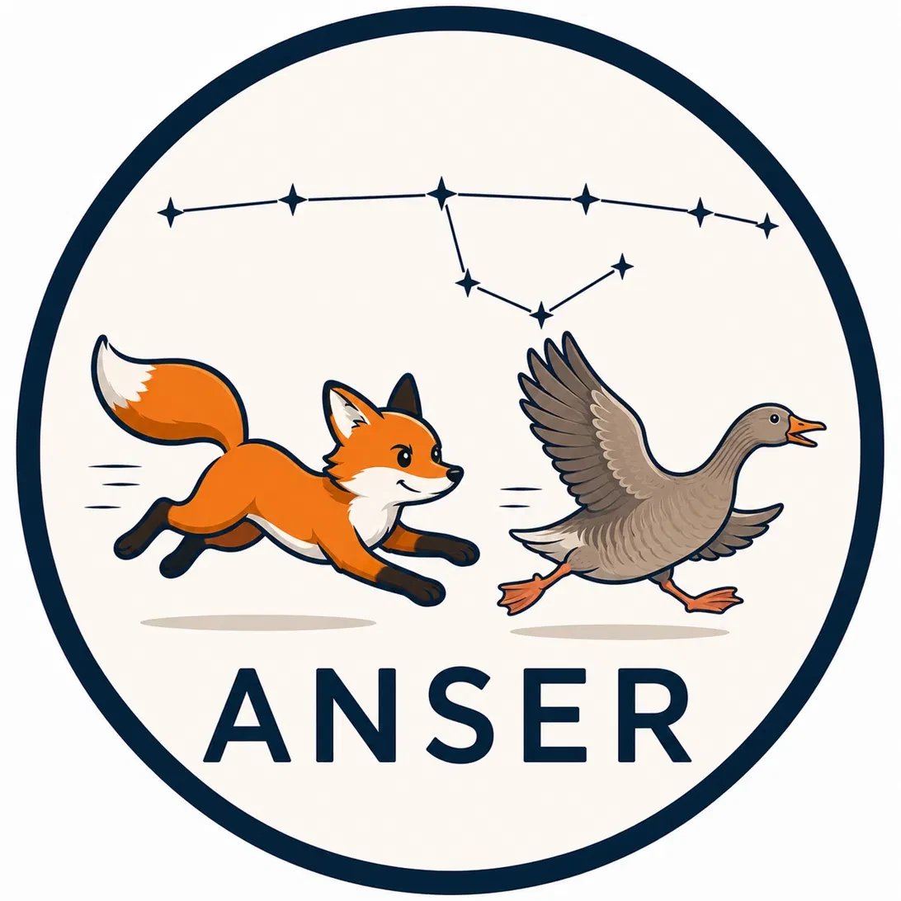

<p align="center">
  
</p>

# ANSER

A queryable catalog of star patterns (asterisms and constellation figures),
built for observation planning.

Existing catalogs sort by object type, so you can find every globular cluster
but you can't ask "what's worth pointing 10x50 binoculars at tonight?"
Asterisms like the Coathanger fall through the cracks completely because they
aren't objects. They're a set of stars plus a claim about a shape.

ANSER keys each pattern on its member stars, derives everything else, and adds
a findability score: a percentile for whether a pattern can actually be picked
out of its real star field at a given instrument's limiting magnitude.

The name comes from Anser, the goose in Hevelius's Vulpecula cum Ansere. The
goose got eaten twice: once by the fox, and again when the IAU shortened the
name to Vulpecula. It's also a homophone for "answer."

## Status

Early and in progress. So far ANSER reads Stellarium's modern sky culture and
turns its constellation and asterism figures into an edge table. Star
crossmatching, the catalog, the night-sky query and findability come next.

## Setup

Needs [uv](https://docs.astral.sh/uv/). From the repo root:

```bash
uv sync
uv run pytest
```

The tests run offline.

## Building the figure table

```bash
uv run python -m anser.stellarium_parse
```

This downloads Stellarium's `modern/index.json` (pinned to v26.3) into
`data/cache/` if it isn't there yet, then writes
`data/cache/stellarium/v26.3/figure_edge.parquet`. Stellarium's data is
GPL-licensed, so it's downloaded on demand and never committed; `data/cache/`
is git-ignored.

`figure_edge` has one row per drawn segment. Every column is a string:

| Column | Example | Meaning |
| --- | --- | --- |
| `sky_culture` | `modern` | Stellarium's sky culture ID |
| `figure_id` | `AST modern CoH` | Stellarium's figure ID (this one is the Coathanger) |
| `kind` | `asterism` | `constellation` or `asterism` |
| `star_a`, `star_b` | `hip:95584` | The two ends, sorted so `star_a < star_b` |

Star IDs are namespaced by catalog: `hip:` for Hipparcos, `gaia_dr3:` for
Gaia DR3, and `dso:` for the one line Stellarium draws to a deep-sky object
(IC 2602, in the Shadow Cross). Stellarium's unnamed "ray helper" lines,
which point from one pattern to another, are left out.

Query it straight from DuckDB:

```sql
SELECT kind, count(DISTINCT figure_id) AS figures, count(*) AS edges
FROM 'data/cache/stellarium/v26.3/figure_edge.parquet'
GROUP BY kind;
```

## License

MIT. Stellarium's sky culture data, downloaded at build time, is under
Stellarium's own GPL license.
